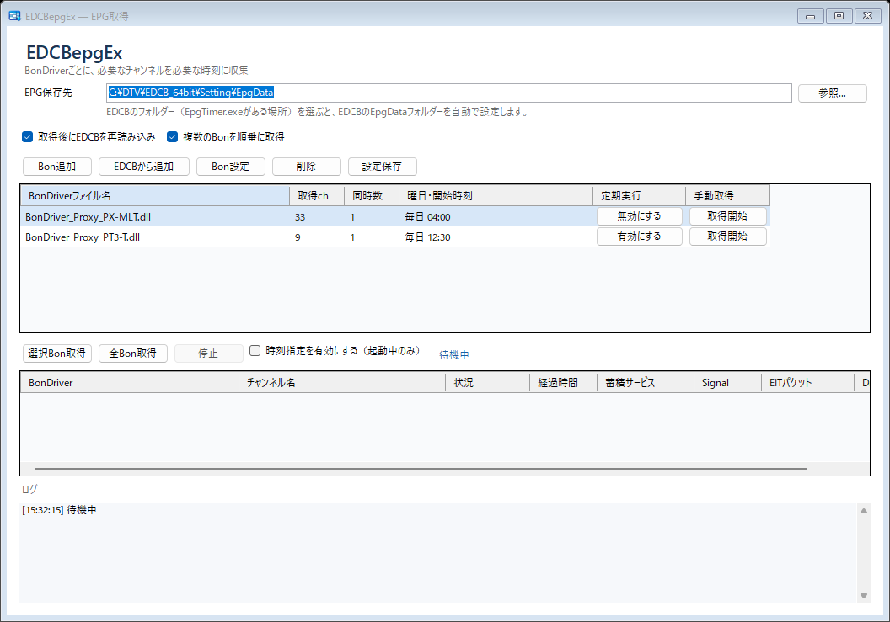

# EDCBepgEx

EDCB用のEPG（番組表データ）を、BonDriverごとに独立して収集するWindowsアプリです。
BonDriverごとに取得するチャンネル・同時取得数・実行する曜日と時刻を指定でき、取得したデータはEDCBの`Setting\EpgData`へ保存します。

EDCB本体のコード・ini・ChSet4は変更しません。

## 主な機能

- BonDriverごとに対象チャンネル・同時取得数・スケジュールを設定
- 複数のBonDriverを並列に、または1つずつ順番に取得（32bit／64bit BonDriverの混在可）
- 曜日・時刻を指定した定期取得と、行ごとの手動取得
- 地デジ・BS・CS・スカパー！の種別ごとの一括選択、BS/CSの「基本情報のみ取得」
- 取得後にEDCBへEPG再読み込みを通知（任意）
- 不完全な取得や放送IDの不一致では既存のdatを置き換えない保護、1世代のバックアップ

## 動作環境

- Windows（.NET Framework 4.8以降。Windows 10/11には標準で入っています）
- 使用するBonDriver（BonDriverのインターフェースを持つDLL）と、対応するChSet4ファイル
- 取得したEPGを使うEDCB（同じPCで動いている場合は再読み込み通知も可能）

.NETランタイムの追加インストールは不要です。

## インストール

1. Releasesから`EDCBepgEx-<バージョン>.zip`（例：`EDCBepgEx-1.0.0.zip`）をダウンロードします。
2. ZIPを任意のフォルダーにすべて展開します。exeだけでなく、付属のDLL・`EDCBepgEx.exe.config`・`native`フォルダーも必要です。
3. `EDCBepgEx.exe`を起動します。

設定はexeと同じフォルダーの`config.json`に保存されます。別のPCや別フォルダーへ移すときは`config.json`をコピーすれば設定を引き継げます。その場合はBonDriver・ChSet4・保存先のパスを確認してください。

アンインストールはフォルダーごと削除するだけです。レジストリは使用しません。

## 使い方

1. **EPG保存先**に、利用中のEDCBの`Setting\EpgData`を指定します。
   - 参照でEDCBのフォルダー（`EpgTimer.exe`がある場所）を選ぶと、EpgDataフォルダーを自動で設定します。EDCBで設定関係保存フォルダを変更している場合（`Common.ini`の`DataSavePath`）もそちらを使います。
   - 初めて使うときは、空のテスト用フォルダーを指定して動作を確認することをおすすめします。
2. **Bon追加**で、BonDriverのDLL、対応するChSet4、取得するチャンネル、同時取得数を指定します。
   - EDCBの`BonDriver`フォルダーのDLLを選ぶと、EDCBの`Setting`フォルダーから同じ名前のChSet4（`BonDriver名(チューナー名).ChSet4.txt`）を探して自動で指定します。見つからない場合はDLLと同じフォルダーを探します。
   - **EDCBから追加**で、EDCBの`BonDriver`フォルダーにあり、ChSet4がそろっている未登録のBonDriverをまとめて追加できます。全チャンネルを選択し、定期実行は無効の状態で追加します。
   - ChSet4はファイルを指定すると自動で読み込みます。
   - チャンネルはチェック欄をクリックして選択します。地デジ・BS・CS・スカパー！・その他のチェックで種別ごとに一括選択できます。
   - DLL名が`BonDriver`で始まらなくても選択できます。
3. 一覧の各行の**取得開始**で、そのBonDriverの取得を手動で始めます。**全Bon取得**ですべての設定を取得します。
   - 一覧でCtrl／Shiftを押しながらクリックすると複数のBonを選べます。**選択Bon取得**で選んだBonだけを取得します。
   - 取得中に別の行の取得開始を押すと、並列で取得します。
   - **複数のBonを順番に取得**（初期状態はオン）がオンのときは、1つのBonの取得が終わってから次のBonを始めます（全Bon取得・選択Bon取得・時刻指定は一覧の表示順で上から、取得中に押したものは最後に追加）。1つのBon内の同時取得数はそのまま使います。各行の**取得開始**は例外で、順番を待たずにすぐ並列で取得します。オフにすると複数のBonを並列で取得します。
   - 取得中でもBonの追加や設定の確認・編集ができます。変更は次回の取得から反映されます。
   - 取得中のボタンは「停止」に変わり、そのBonDriverだけを止められます。下の停止ボタンはすべてを止めます。
4. 定期実行するときは、Bon設定の「曜日・時刻指定」で曜日にチェックを入れ、時・分を選んで**追加**します。複数登録できます。
   メイン一覧の**定期実行**ボタンでBonDriverごとに有効・無効を切り替え、全体の**時刻指定を有効にする**をオンにします。
5. **取得後にEDCBを再読み込み**（初期状態はオン）がオンのときは、取得結果を同じPCのEDCBにすぐ反映します。不要ならオフにします。

起動しただけでは受信・保存・EDCBへの通知は行いません。全体の「時刻指定を有効にする」は起動するたびにオフに戻ります。

### 定期実行について

- アプリが起動していて、PCが起きている間だけ動きます。最小化していても動作します。
- Windowsサービスへの登録、自動起動、スリープからの復帰は行いません。
- PCが停止していた間の取得を、後からまとめて実行することはありません。
- 同じ設定がすでに取得中のときは、その回の取得を見送ります。

### 一覧の表示

- 列見出しのクリックで並べ替え、ドラッグで列幅・列順を変更できます。右クリックで列の表示・非表示と初期状態へのリセットができます。列の設定は終了時に保存されます。
- 定期実行列のボタンは、有効なBonでは「無効にする」、無効なBonでは「有効にする」と表示されます。定期実行が無効でも手動取得は可能です。
- 「複数のBonを順番に取得」がオンなら、同じ時刻に定期実行するBonも一覧の上から順に取得します。
- 取得中一覧には、Space・ch・ONID・TSID・対象SID・ワーカーのビット数・Drop・保存ファイル・エラー内容などの列も用意しています。必要に応じて見出しの右クリックで表示してください。
- Dropは選局後に受信したTSの、PIDごとの連続性カウンター不連続回数の合計です（EDCBのDropCountと同様の数え方）。欠落パケット数の推定値ではありません。

## 取得と保存の仕組み

- 32bit BonDriverにはx86、64bit BonDriverにはx64の受信ワーカーを使います。ワーカーはそれぞれ別プロセスで動きます。
- 選局後、受信したONID/TSIDが対象と一致してから保存を始めます。
- EpgDataCap3.dllでEPGの蓄積完了を確認します。EpgDataCap_Bonの既定の動作に合わせ、最低60秒蓄積した後、10秒ごとに完了を確認します。タイムアウトは10分です。ただし、選局後60秒たっても対象のONID/TSIDを受信できない場合や、EITを1パケットも受信できない場合は、その時点で失敗として次へ進みます。判定の対象は通常のテレビ・音声サービスで、ワンセグ・データ放送専用サービスは対象外です。
- 取得中のデータは`temp`フォルダーに一時保存し、完了後に`ONID4桁TSID4桁_epg.dat`へ置き換えます。
- 放送IDの不一致、中止、タイムアウト、解析・書き込みの失敗のいずれかが起きた場合は、既存のdatを置き換えません。
- 取得中に既存のdatが変更された場合や、EDCBが同名の`.tmp`を作成中の場合は保存を見送ります。
- 置き換え前のdatは、保存先の`CollectorBackup`フォルダーに1世代保持します。
- BonDriverのオープンに失敗した場合はログに記録して次へ進みます。オープン・選局が応答しない場合はワーカーを終了させ、他のBonDriverの取得は継続します。
- 別々の設定で同じONID/TSIDを選んだ場合、1回の実行では一覧で先にある設定にまとめます。同じDLLを使う複数の設定は順番に実行します。

### 基本情報のみ取得（BS・CS）

BS・CS1・CS2・CS3を含むChSet4では「基本情報のみ取得」を選べます。既定値はEpgDataCap_Bonと同じく、BS・CS1・CS2がオン、CS3がオフです。
基本取得では同じネットワークをまとめて`ONID4桁FFFF_epg.dat`に保存し、詳細取得ではTSごとに保存します。この設定は本アプリ側だけのもので、EDCBの設定は変更しません。

### datの履歴とサイズ

既存のdatがある場合は、旧datのTSデータの後に新しく受信したTSを追記して保存します。EDCBは新しい情報を優先して読み込み、今回受信しなかった過去の番組情報もdat内に残ります。

**この追記によりdatは取得のたびに大きくなります。** 期限・容量上限・自動の間引きはなく、EDCBの「保存日数」設定でも整理されません。読み込み時間とバックアップの容量も増えるので、必要に応じてdatを削除してください。
EDCBの「過去番組を保存」はEDCB側のアーカイブ機能で、本アプリのdat履歴とは別の仕組みです。本アプリはEDCBのアーカイブファイルや設定を変更しません。

### EDCBへの再読み込み通知

「取得後にEDCBを再読み込み」がオンの場合、保存後に同じPCの`EpgTimerSrvPipe`へ再読み込みを要求します。要求が受け付けられても、番組表への反映は非同期で行われます。
`EpgTimerSrvPipe`はEDCBへの通知先で、BonDriverやProxyExの接続先ではありません。

## 確認状況

- 地デジのdatを使ったx86/x64での解析、dat保護・バックアップ・設定保存・スケジュール・EDCB通信などは、自動テストで確認しています。
- 模擬BonDriverを使い、並列取得（x86/x64混在で計4本）、中止、オープン失敗・応答停止、受信TSの切り替わりを確認しています。
- BonDriverProxyEx経由の実チューナーで、地デジの受信・保存と、稼働中のEDCBへの反映を確認しています。
- BS/CSは、選局計画・保存名の処理をテスト済みですが、実際の受信による基本／詳細の判定は未確認です。
- スカパー！（SPHD）と、CATVのトランスモジュレーション（一覧では「その他」に分類）は、実際の受信では未確認です。動作した・しなかったという報告を歓迎します。

## ライセンス・第三者コード

本アプリ独自部分は[MIT License](LICENSE)です。

EPG解析用の`EpgDataCap3.dll`とBonDriverインターフェースの定義には、[EDCB](https://github.com/xtne6f/EDCB)のソースを利用しています。これらはEDCBの`Document\Readme.txt`の条件に従います（フリーソフトへの組み込み・改変は可。無許可での商用・シェアウェアへの組み込みは不可）。詳細は[THIRD-PARTY-NOTICES.txt](THIRD-PARTY-NOTICES.txt)を参照してください。

ビルド方法と開発者向けの情報は[BUILDING.md](BUILDING.md)にあります。
